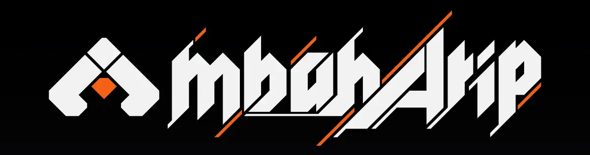

<div align='center'>
  
</div>
<div align='center'>
  <span style='font-size:10px;'>Logo by <a href='https://twitter.com/RINYA_P' target='_blank' rel='noopener noreferrer'>りにゃ (RINYA_P)</a></span>
</div>

<!-- ABOUT:START -->
### Hi there!
I'm **Arief Rachmawan**, a developer based in **Bandung, Indonesia**.  
I specialize in building modern web applications using Next.js, React, and TypeScript, styled with Tailwind CSS. 

Let's create something amazing together!
<!-- ABOUT:END -->


<p align='center' style='color:rgba(110,110,110)'>
  <a href='https://www.mbaharip.com' target='_blank' rel='noopener noreferrer'>
    Portfolio Site
  </a>
</p>


---

### 📊 Wakatime stats

<!--START_SECTION:waka-->

```txt
Total Time: 26 hrs 5 mins

TypeScript       12 hrs 45 mins        ⣿⣿⣿⣿⣿⣿⣿⣿⣿⣿⣿⣦⣀⣀⣀⣀⣀⣀⣀⣀⣀⣀⣀⣀⣀   45.73 %
Markdown         3 hrs 55 mins         ⣿⣿⣿⣦⣀⣀⣀⣀⣀⣀⣀⣀⣀⣀⣀⣀⣀⣀⣀⣀⣀⣀⣀⣀⣀   14.05 %
Rust             2 hrs 6 mins          ⣿⣷⣀⣀⣀⣀⣀⣀⣀⣀⣀⣀⣀⣀⣀⣀⣀⣀⣀⣀⣀⣀⣀⣀⣀   07.57 %
Other            1 hr 47 mins          ⣿⣶⣀⣀⣀⣀⣀⣀⣀⣀⣀⣀⣀⣀⣀⣀⣀⣀⣀⣀⣀⣀⣀⣀⣀   06.45 %
Pawn             1 hr 37 mins          ⣿⣦⣀⣀⣀⣀⣀⣀⣀⣀⣀⣀⣀⣀⣀⣀⣀⣀⣀⣀⣀⣀⣀⣀⣀   05.80 %
```

<!--END_SECTION:waka-->
